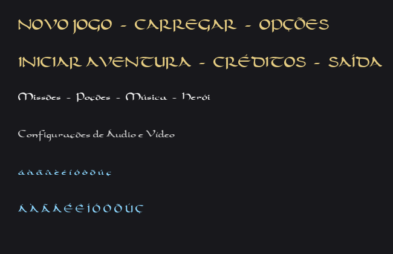

# Sacred Gold — Tradução Português do Brasil (PT-BR)

Projeto de tradução para **Sacred Gold**, acompanhado de fonte personalizada com suporte completo à acentuação da língua portuguesa.



---

## Destaques

- **Tradução Completa (PT-BR)**: Textos e tabelas de recursos traduzidos para português.
- **Revisão pelo Novo Acordo Ortográfico**: Vocabulário, termos e gramática revisados conforme as regras vigentes do Novo Acordo Ortográfico da Língua Portuguesa (atualização de tremas obsoletos, ajustes em ditongos abertos e correções de crase, acentuação e digitação).
- **Fonte Personalizada (`CAROLING.TTF`)**: A fonte padrão dos menus do Sacred Gold (*Carolingia*) originalmente não continha glifos desenhados para vários acentos comuns (`ã`, `í`, `ó`, `õ`, `ú`, etc.), resultando em letras invisíveis ou falhas nos botões. Esta versão traz os contornos adicionados artesanalmente com base no estilo original da fonte.
- **Formato Aberto para a Comunidade**: O arquivo `texts.json` disponibiliza todas as 23.828 linhas de diálogo, itens e missões em formato aberto para revisão e melhorias contínuas.

---


## Como Instalar no Jogo

1. **Copie as fontes**:
   Copie os arquivos de `fonts/` para a pasta de fontes do jogo:
   ```text
   C:\Program Files (x86)\Steam\steamapps\common\Sacred Gold\font\
   ```

2. **Copie a pasta de tradução**:
   Copie a pasta `scripts/pt` para dentro da pasta `scripts` do jogo:
   ```text
   C:\Program Files (x86)\Steam\steamapps\common\Sacred Gold\scripts\pt\
   ```

3. **Ative a linguagem**:
   - Utilize o [sacred-gold-language-loader](https://github.com/leonardokr/sacred-gold-language-loader) para permitir que o jogo carregue o idioma PT e pastas de tradução externas sem modificar o executável.
   - Certifique-se de que no seu `Settings.cfg` o idioma está configurado como:
     ```ini
     LANGUAGE : PT
     ```

---

## Como Contribuir para a Tradução

Todos os textos estão descompactados em [`texts.json`](texts.json). Qualquer pessoa pode abrir o arquivo em um editor de texto (VSCode, Notepad++, etc.) para corrigir termos, pontuações ou traduzir novas linhas.

### Configurar o ambiente:
```bash
python -m venv .venv
.\.venv\Scripts\activate      # Windows (ou source .venv/bin/activate no Linux/macOS)
pip install -r requirements.txt
```

### Recompilar após editar o `texts.json`:

```bash
python tools/res_tool.py pack texts.json scripts/pt/global.res
```

### Descompactar um `global.res` existente:
```bash
python tools/res_tool.py unpack scripts/pt/global.res texts.json
```


---

## Licença

As fontes e textos originais pertencem a seus respectivos criadores e à Ascaron Entertainment. As correções tipográficas e ferramentas deste repositório são disponibilizadas livremente para a comunidade de jogadores e modders de Sacred Gold.
